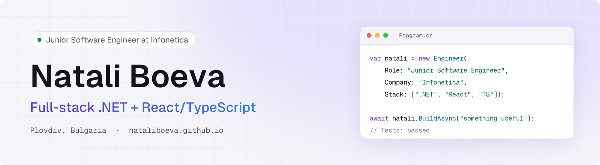
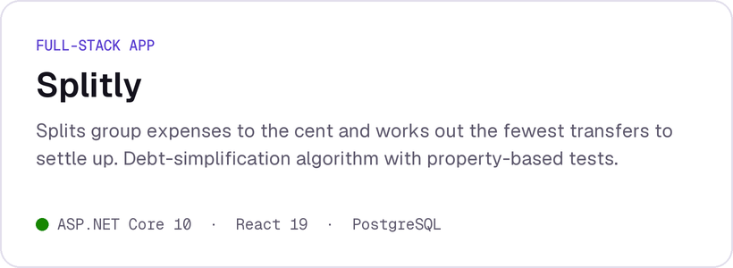
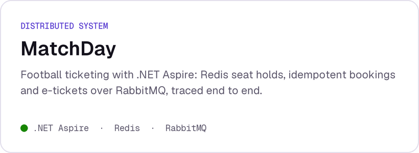
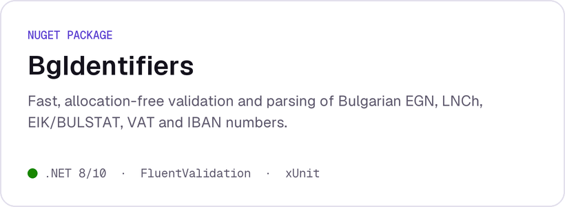
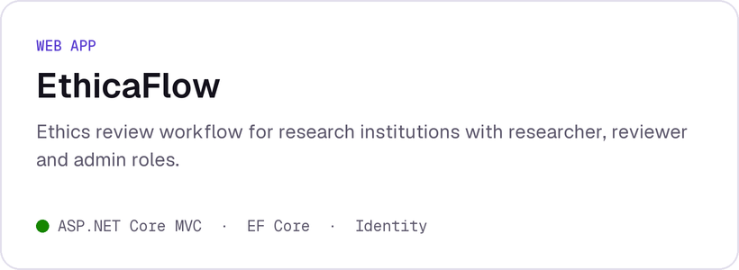
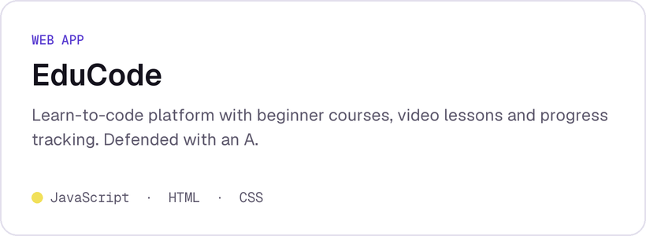

<a href="https://nataliboeva.github.io">
  <picture>
    <source media="(prefers-color-scheme: dark)" srcset="assets/banner-dark.png">
    
  </picture>
</a>

  
  

## About me

I build web applications end to end, from ASP.NET Core APIs and EF Core data models to typed React frontends. I care about the parts that make software trustworthy: tests, clear domain logic and readable code.

- 💼 **Junior Software Engineer at [Infonetica](https://www.infonetica.net)** since February 2026, working across a .NET backend and a React + TypeScript frontend. That work lives in private company repositories, so this profile shows my personal projects.
- 🎓 **BSc in Software Engineering** at the University of Plovdiv "Paisii Hilendarski" (2025 – 2029)
- 📜 **10 SoftUni certificates**, including ASP.NET Advanced, Entity Framework Core and Microsoft SQL Server

## Featured projects

  <a href="https://github.com/nataliboeva/splitly"><picture><source media="(prefers-color-scheme: dark)" srcset="assets/splitly-dark.png"></picture></a>
  <a href="https://github.com/nataliboeva/matchday"><picture><source media="(prefers-color-scheme: dark)" srcset="assets/matchday-dark.png"></picture></a>
  <a href="https://github.com/nataliboeva/bg-identifiers"><picture><source media="(prefers-color-scheme: dark)" srcset="assets/bgid-dark.png"></picture></a>
  <a href="https://github.com/nataliboeva/Travellark"><picture><source media="(prefers-color-scheme: dark)" srcset="assets/travellark-dark.png"></picture></a>
  <a href="https://github.com/nataliboeva/EthicaFlow"><picture><source media="(prefers-color-scheme: dark)" srcset="assets/ethicaflow-dark.png"></picture></a>
  <a href="https://github.com/nataliboeva/EduCode"><picture><source media="(prefers-color-scheme: dark)" srcset="assets/educode-dark.png"></picture></a>

## Tech stack

  &nbsp;
  &nbsp;
  &nbsp;
  &nbsp;
  &nbsp;
  &nbsp;
  &nbsp;
  &nbsp;
  &nbsp;
  &nbsp;
  &nbsp;
  

**Also:** EF Core · ASP.NET Core Identity · .NET Aspire · TanStack Query · React Hook Form · Zod · Vite · xUnit · Vitest · Testcontainers · OpenTelemetry

---

Happy to talk about .NET, React or an interesting engineering problem. LinkedIn is the quickest way to reach me.
